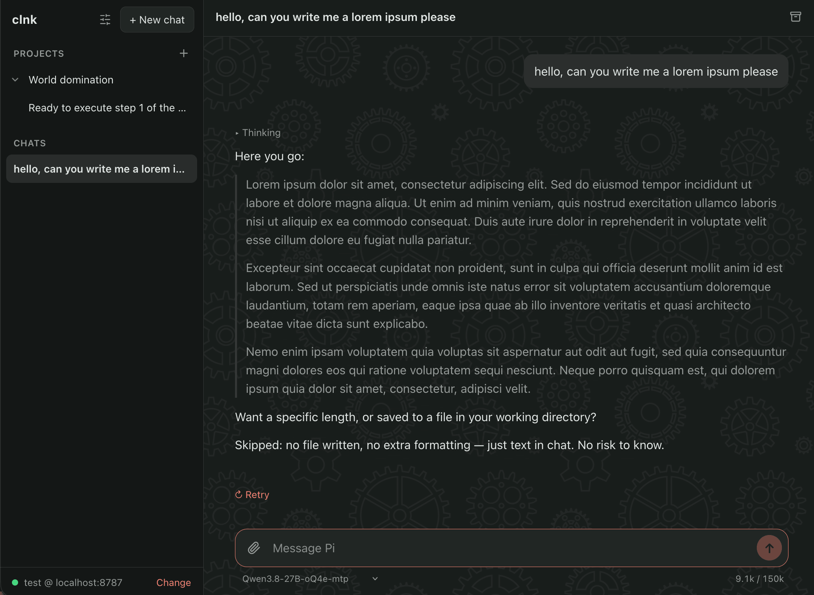
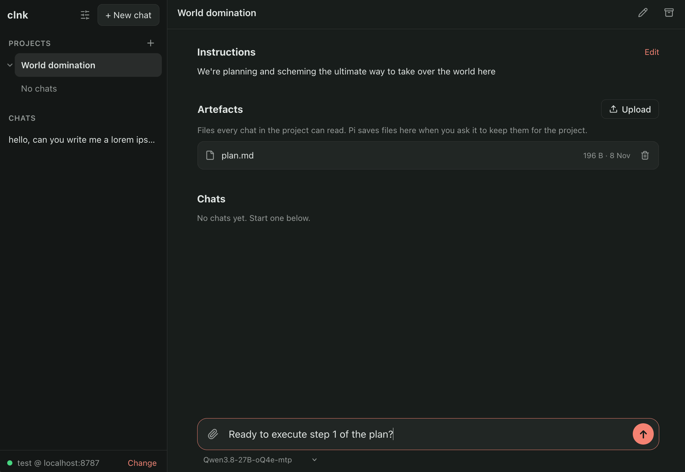
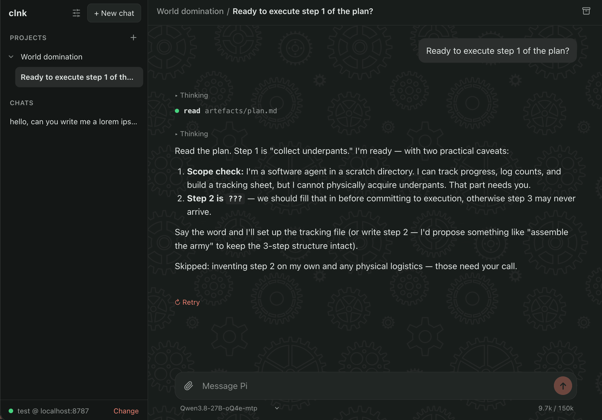

# clnk

A simple(*) frontend for Pi aiming to replicate ease of use and capabilities of other chat harnesses like Claude.

_(\*) inb4 it gets overbloated with features a few weeks from now_

I'm building it for myself to fit my specific needs so it might not be for you. Also, 100% of the code in this repo was vibe coded - but fear not: all docs, including this readme, are/will be written by yours truly.

## Features

For more details see [docs/overview.md](docs/overview.md).

- chat with a self hosted model via OpenAI compatible API and Pi
- projects, with artefacts and chats grouped under them
- web, desktop (MacOS) and mobile (Android)
- dark/light theme (of course all apps need that in 2026), plus ability to choose your own accent colour

## Installation

First, run the Docker container somewhere - see [docker-compose.yml](docker-compose.yml) for instructions.

You'll need to add the first user with `bun run server/users add [username]`, ran inside the container.

Then do any of these:

1. Open the web UI, served by the Docker container
2. Grab a macOS from the [releases page](https://github.com/modrzew/clnk/releases)
3. Grab an Android app from the [releases page](https://github.com/modrzew/clnk/releases)

## Screenshots

<i>An example chat</i>

<i>An example project</i>

<i>A chat inside the example project</i>

## Attributions

**Chat background image**: Floating Cogs from [Hero Patterns](https://heropatterns.com/) by Steve Schoger, [CC BY 4.0](https://creativecommons.org/licenses/by/4.0/)
